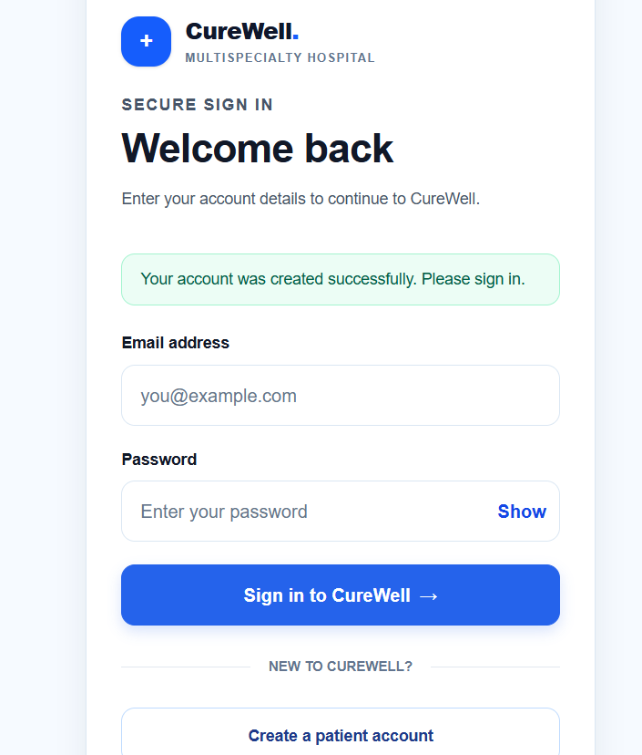
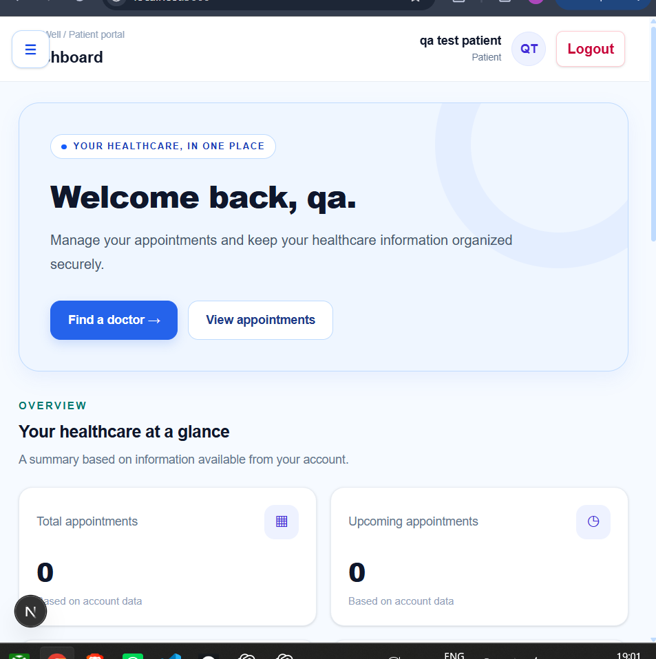
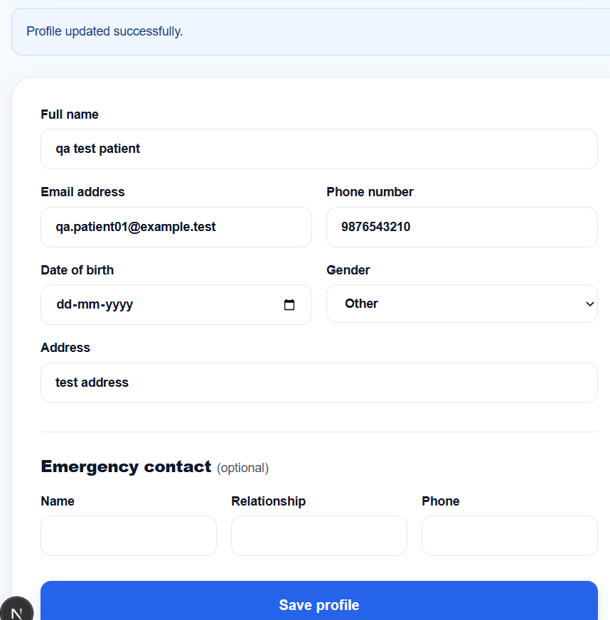
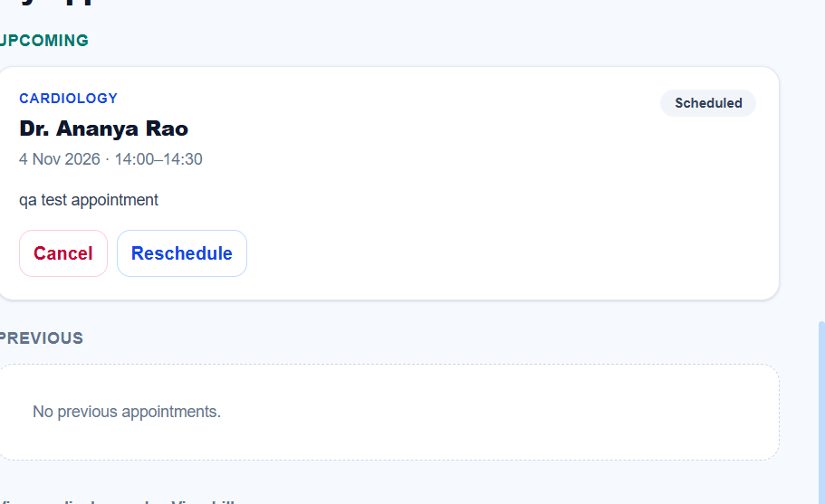
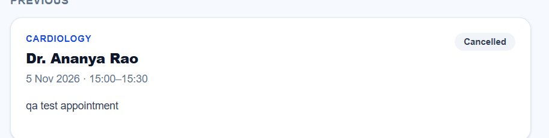
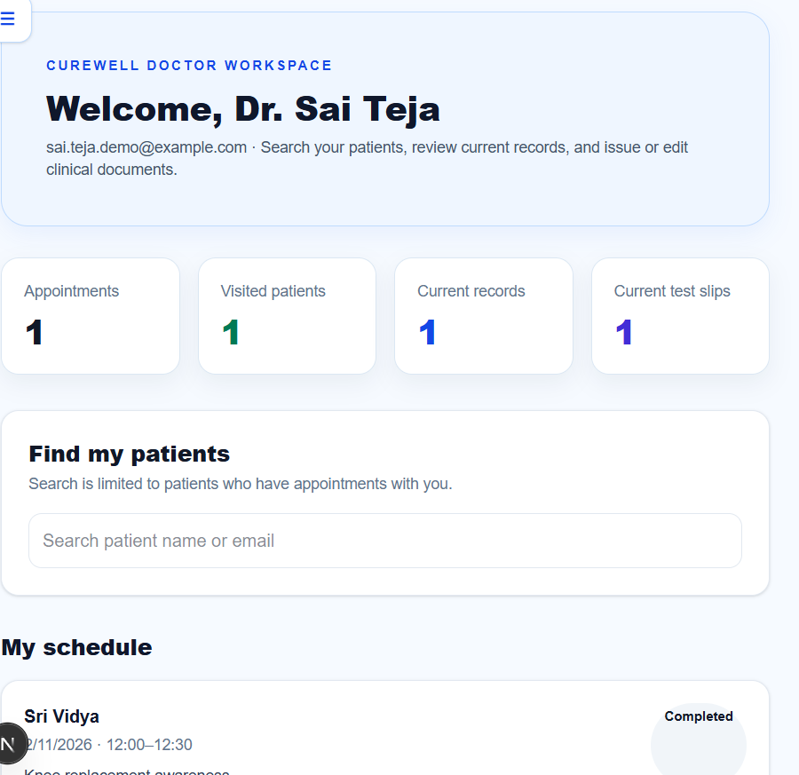
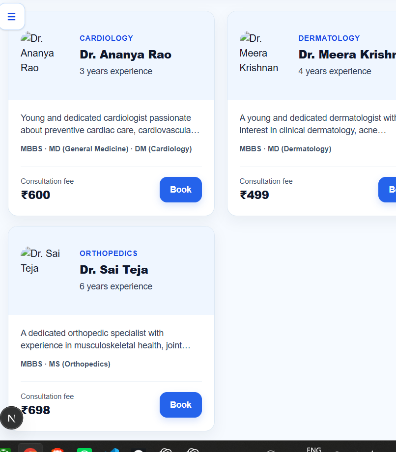
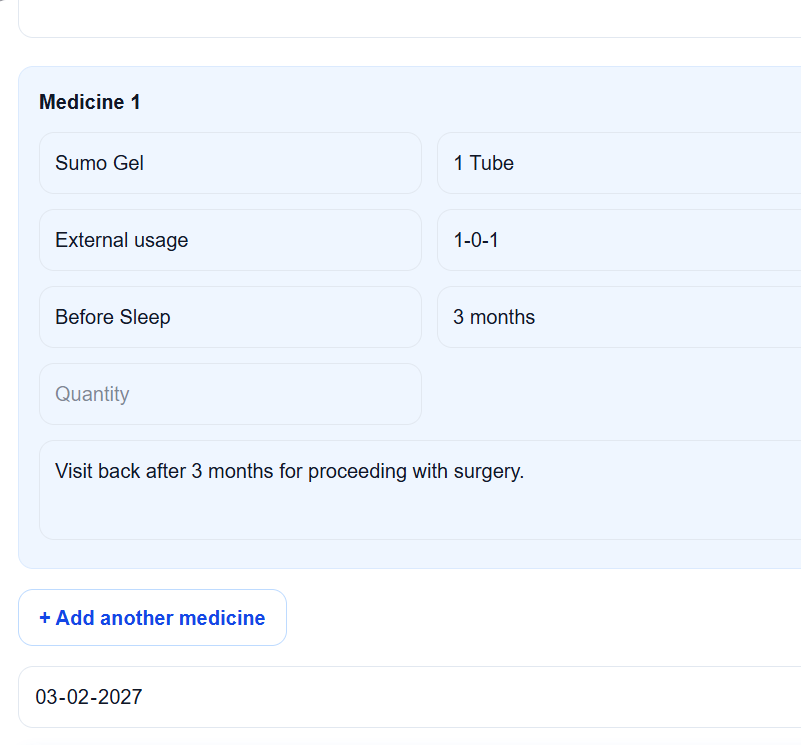

# System Validation Report

## Scope

Manual validation used only fake test accounts and fake patient details in the local development environment.

## Passed Flows

- Registration validation: empty fields, invalid email, short password, and password mismatch.
- Valid patient registration and login.
- Session persistence after refresh and logout access control.
- Patient profile view, update, and persistence after refresh.
- Doctor directory details and appointment availability.
- Appointment booking, rescheduling, and cancellation.
- Patient medical-record access and unauthenticated record protection.
- Doctor dashboard access and review of assigned clinical records.

## Open Defects

| ID | Summary | Severity |
| --- | --- | --- |
| BUG-002 | Logged-out profile fields and Save profile button remain enabled. | Medium |
| BUG-003 | Add another medicine does not add a prescription row. | Medium |
| BUG-004 | Doctor images are broken in the doctor directory. | Low |
| BUG-005 | Logged-out appointment booking controls remain enabled. | Medium |

## Not Run

- Duplicate/conflicting appointment booking.
- Unavailable or past appointment slot validation.
- Successful addition of a new prescription item, blocked by BUG-003.

## Conclusion

Core patient and doctor workflows were successfully validated. The open defects should be fixed and retested before final sign-off.

## Screenshot Evidence

| Scenario | Screenshot |
| --- | --- |
| Registration success |  |
| Session persists after refresh |  |
| Profile update success |  |
| Appointment booking success |  |
| Appointment cancellation |  |
| Doctor workspace |  |
| Broken doctor images defect |  |
| Add-medicine defect |  |
